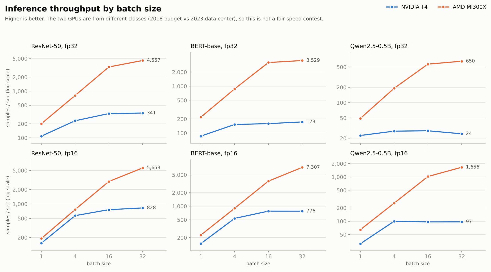
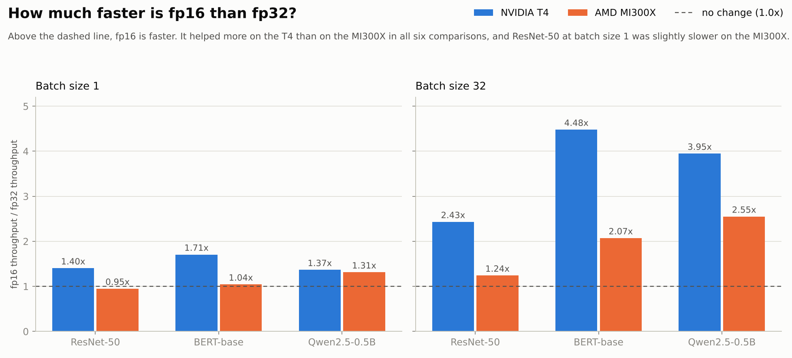
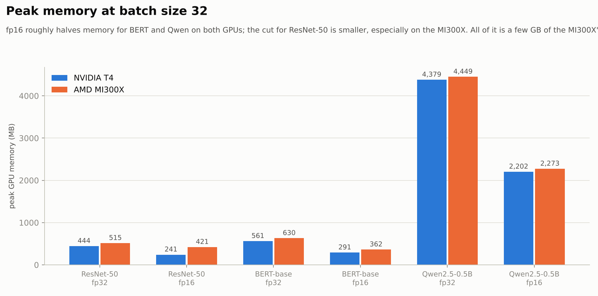

# GPU Inference Benchmark: ROCm (AMD) vs CUDA (NVIDIA)

A small PyTorch benchmark that runs the **same script, unchanged,** on an NVIDIA GPU (CUDA) and an AMD GPU (ROCm), and records latency, throughput, and peak memory for three models across batch sizes and precisions.

I built it to understand what developers actually experience on ROCm compared with CUDA: how hard it is to get onto the hardware, what breaks, and what I would fix as a product manager. The benchmark numbers are secondary. The friction log is the main finding.

## What it measures

| | |
|---|---|
| **Models** | ResNet-50 (images), BERT-base (text understanding), Qwen2.5-0.5B (small language model) |
| **Batch sizes** | 1, 4, 16, 32 |
| **Precisions** | fp32, fp16 |
| **Configurations** | 24 per platform (3 models x 4 batch sizes x 2 precisions) |
| **Metrics** | latency (ms), throughput (samples/sec), peak GPU memory (MB) |

Each configuration does 5 untimed warmup runs, then averages 20 timed runs, with the GPU synchronized before the timer stops. Inputs are random, and ResNet-50 uses random weights, since this measures speed and not accuracy.

## Setup used

| | NVIDIA | AMD |
|---|---|---|
| GPU | Tesla T4 | Instinct MI300X (virtualized, 1 GPU) |
| Where | Google Colab | Rented VM, running AMD's `rocm/pytorch` container |
| PyTorch | 2.11.0+cu130 | 2.14.0+rocm10.1.0 (ROCm/HIP 7.16) |

## How to run

```bash
pip install torch torchvision transformers   # use a ROCm build of PyTorch on AMD
python bench.py
```

It detects the backend automatically (`torch.version.hip` exists only on the ROCm build of PyTorch) and writes a CSV named after the backend and GPU into the current folder.

## Results

All 48 runs (24 per platform) completed with no errors. Raw data is in `results/`.



At batch size 32 (samples/sec):

| Model, precision | T4 | MI300X |
|---|---|---|
| ResNet-50, fp32 | 341 | 4,557 |
| ResNet-50, fp16 | 829 | 5,653 |
| BERT-base, fp16 | 776 | 7,307 |
| Qwen2.5-0.5B, fp16 | 97 | 1,656 |

**This is not a fair speed contest.** The T4 is a 2018 budget GPU (free on Colab) and the MI300X is a 2023 data center flagship (about $3.59/hr to rent). Read the results as "both platforms ran the same code," not "AMD is N times faster."

### Observations

- **Small batches are nearly free on the MI300X.** ResNet-50 fp32 takes about 4.9 ms at batch sizes 1, 4, and 16, so the GPU is far from saturated at small sizes. On the T4, time rose steadily with batch size. I believe this reflects how much spare capacity the larger GPU has, but I did not test the cause.
- **fp16 helped less on the MI300X than on the T4** in all six comparisons shown below, and ResNet-50 at batch size 1 was slightly slower in fp16 (0.95x). I did not investigate why.



- **fp16 roughly halves memory for BERT and Qwen on both GPUs.** The saving for ResNet-50 is smaller, especially on the MI300X.



## Friction log (the main finding)

Once I was on the machine, the ROCm software was easy: the same script ran with no code changes and all 24 configs passed. Getting access to an AMD GPU was the hard part. See [`FRICTION_LOG.md`](FRICTION_LOG.md) for the full list of issues, what was easy, and how I would prioritize fixes.

## Limitations

- Different GPU classes and different software versions on each side.
- One run per configuration (20 timed iterations averaged). No repeated experiments or error bars.
- Random inputs and weights: measures speed, not accuracy.
- Language models are timed on a single forward pass over 128 tokens, not full text generation.
- These small models use only a few GB of the MI300X's 192 GB, so they do not stress what the chip is built for.
- The MI300X was a virtualized slice passed through to a VM.

## Possible next steps

- Compare like-for-like hardware (for example, MI300X vs H100).
- Add repeated runs and report variance.
- Time real text generation (tokens per second) for the language model.
- Test larger models that actually use the MI300X's memory.
- Investigate why fp16 helped less on the MI300X.

## Repository layout

```
bench.py            the benchmark script
results/            raw CSVs from each platform
charts/             throughput, fp16 speedup, and memory charts
FRICTION_LOG.md     setup issues, what was easy, and proposed priorities
```
